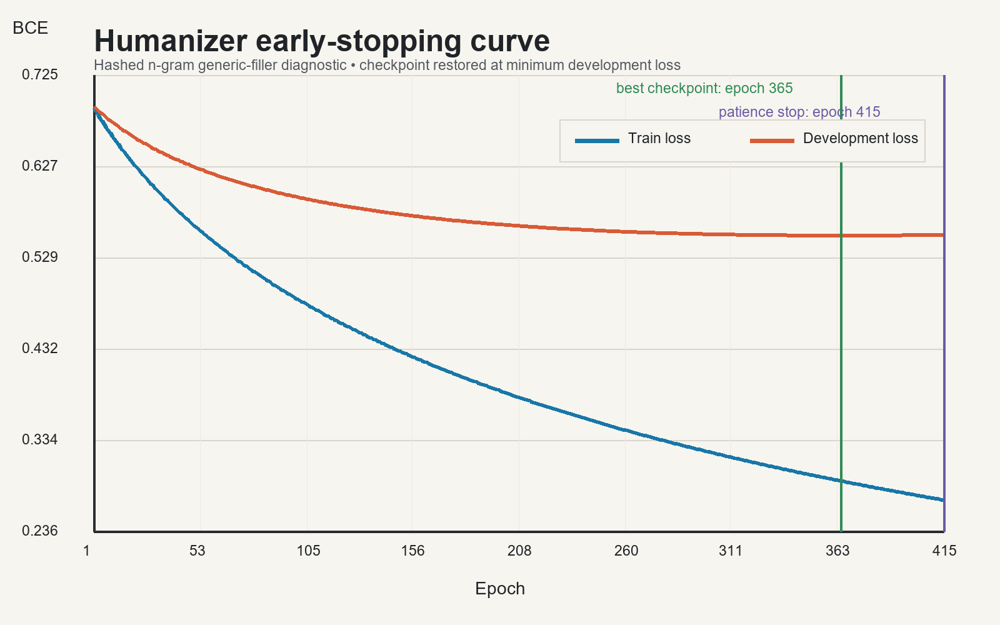

# HumanizerSkill — evidence-preserving bilingual academic revision

**English** | [中文](README.zh-CN.md)

Humanizer revises Chinese and English academic prose while locking facts, numbers, citations,
quotations, uncertainty, and claim strength. It removes empty scaffolding and improves reasoning
visibility, but it refuses detector evasion, fabricated evidence, and authorship laundering.

The executable Skill and private evaluation artifacts live in the private
`Shawn200212/HumanizerSkill-core` repository. This public repository contains the reproducible
method summary, a CC0 bibliographic manifest, aggregate metrics, and the early-stopping curve. It
does not publish Skill instructions, paper abstracts, full text, the trained diagnostic, private
test material, or user manuscripts.

## Corpus snapshot

- 200 OpenAlex records: exactly 100 Chinese and 100 English.
- Paper-level split: 140 train, 30 development, 30 test; 70/15/15 per language.
- 182 journal articles and 18 conference papers across 200 distinct venues.
- Metadata and abstracts only in the private core; no paper PDFs or full text were downloaded.
- Selection is deterministic and field-balanced, but is not an exhaustive census or a claim that
  every venue is “mainstream.”

OpenAlex metadata is CC0. A location-level license value is only a discovery signal: it does not
replace article-level rights review. The public `metadata_manifest.csv` therefore contains
bibliographic metadata and hashes, not abstracts or full text.

## Early stopping result

The trained component is a narrow synthetic generic-filler diagnostic—not an AI detector and not
the Skill itself. Development loss reached its minimum at epoch 365. Training continued only for
the predeclared patience window, stopped at epoch 415, and restored epoch 365 before one-time test
evaluation.

| Frozen test metric | Value |
|---|---:|
| Samples | 334 |
| Balanced accuracy | 0.9701 |
| Authentic-sentence F1 | 0.9691 |
| Synthetic-filler F1 | 0.9709 |
| Binary cross-entropy | 0.5028 |

These results apply only to deterministic filler injection over the frozen abstract snapshot. They
do not measure factual accuracy, authorship, detector evasion, overall revision quality, or paper
acceptance.

## Public files

- `data/metadata_manifest.csv` — 200 CC0 bibliographic rows and record hashes.
- `data/dataset_summary.json` — frozen composition and source hash.
- `data/performance_summary.json` — bounded aggregate result and limitations.
- `data/learning_curve.csv` — epoch-level losses used by the visualization.
- `docs/method-and-boundaries.md` — split, early-stop, licensing, and interpretation contract.
- `reports/training-report.md` and `gallery/` — concise report and PNG/SVG curve.

## Licensing

Repository prose and private Skill source remain all rights reserved; see `LICENSE`. Public
aggregate measurements and CC0-derived bibliographic metadata in `data/` are released under
CC BY 4.0; see `LICENSE-DATA`. Underlying articles remain subject to their publishers’ or authors’
licenses.
